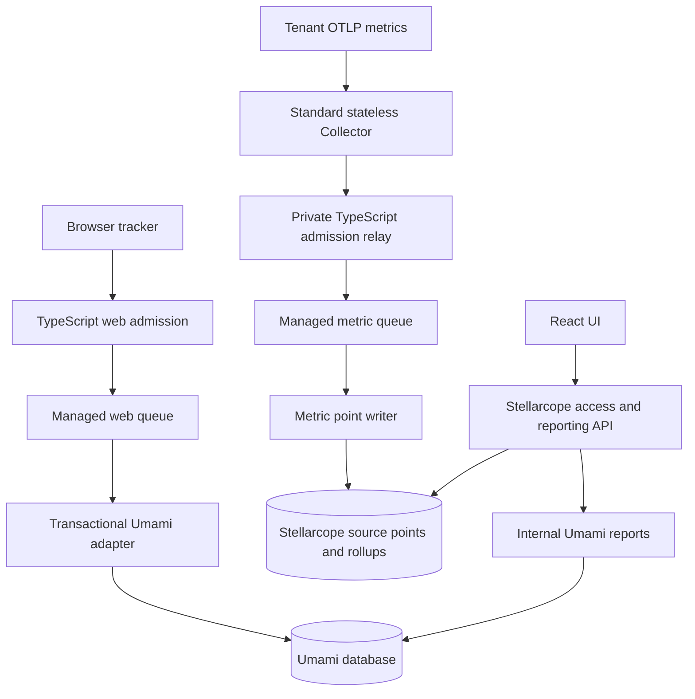

# Technology decisions

This document records Stellarcope's technology and design decisions and the evidence behind each one. It resolves the choices left open in the [original architecture proposal](architecture-proposal.md) and [stack research](stack-research.md), and supersedes them wherever they differ. The [technical architecture](technical-architecture.md) describes the resulting system.

## Selected stack

| Concern | Decision | Evidence and tradeoff |
|---|---|---|
| Runtime | Node **26.13.1 LTS** for deployment; Node **24.22.3** is the tested compatibility floor | Both run the focused tests; the upgraded application builds and its existing tests pass on 26. No reason to introduce another runtime. |
| Compiler | TypeScript **6.0.3** | TS 7.0.2 type-checks the fixture, but strict installation with current typed linting fails. Select the supported package combination rather than bypass peer checks or maintain two compilers. |
| HTTP | Fastify **5.12.8** | Runtime validation, typed status/response contracts, serialization, and beacon parsing exercised. Keep one modular application with distinct process roles. The implemented skeleton uses separate public/private instances and retains 503 readiness/admission until the later integrations. |
| Schemas | TypeBox **1.4.7**, `@fastify/type-provider-typebox` **6.3.0** | Both TypeBox and Zod passed the comparison. TypeBox fits the selected JSON Schema path directly. Do not ship both. Microbenchmark timings are secondary to integration simplicity. |
| HTTP documentation | `@fastify/swagger` **9.9.4**, OpenAPI **3.0.3** initially | Generated contracts validate with Swagger Parser 13.1.0. No required feature needs 3.2; expanding the specification dialect adds no demonstrated benefit now. |
| SQL | PostgreSQL **17**, maintained minor; `pg` **8.23.1** | Tested against 17.12, including transactions, histogram vectors, large integers, and real Umami tables. Use the current supported patch available on the managed provider. |
| Migrations | `node-pg-migrate` **9.0.0**, versioned SQL files | Real up migration and repeat/no-op run tested. Keep Umami's migrations separate. No ORM or new query abstraction is needed. |
| Authentication | JOSE **6.2.17**, standard Collector OIDC, Stellar SDK **17.4.0** for SEP-10 | JWT expiry, required claims, issuer/audience behavior, spoofing, SEP-10 domain checks, and local transaction signing exercised. These are primitive/integration checks, not a delivered enrollment system. |
| Telemetry | Official Collector **0.165.0** components, rebuilt with Go **1.27.4** and x/crypto **0.59.0**; JS API **1.10.0**, SDK/resources **3.0.0**, exporters **0.300.0** | Actual SDK JSON and Protobuf paths tested. The public Collector handles OTLP; the application consumes a bounded normalized profile. |
| Frontend | React/DOM **19.3.1**, Router **7.18.5**, Vite **8.3.8**, React plugin **6.3.0**, Tailwind Vite plugin **4.3.5** | Built in an isolated source copy and smoke-tested across five routes in Chrome. Requires only the documented type migrations, not a component rewrite. |
| Lint/format | ESLint **10.15.0**, typescript-eslint **8.72.2**, Prettier **3.10.1** | Positive checks and deliberately broken promise/type examples exercise the guardrails. Apply new checks as modules are migrated; avoid a repository-wide formatting rewrite. |
| Delivery SDK | AWS SQS client **3.1169.0** | Actual SDK exercised against pinned ElasticMQ 1.7.1. The emulator is test infrastructure, not the selected production broker. |

The [typed-linting support range](https://typescript-eslint.io/users/dependency-versions/) is a material limit: currently `>=4.8.4 <6.1.0`. A newer compiler release does not establish compatible lint tooling. The chosen runtime/package versions are frozen in the [lab manifest and lockfile](../experiments/stack/package.json); test-only alternatives and tools in that manifest must not all become production dependencies.

The frontend snapshot needed `RefObject<HTMLElement | null>` in two hook signatures and an explicit `Buffer` annotation in the old salt class. Those are recorded in `prepare-snapshot.mjs`. No application source was edited. Browser checks use synthetic API responses and block all external requests; they establish rendering compatibility, not production backend or visual parity certification.

## Refined architecture

The primary region is AWS **eu-central-1** (Frankfurt). It runs:

- stateless ECS/Fargate ingress and worker roles
- internal Umami
- RDS PostgreSQL Multi-AZ
- **SQS Standard with separate web and metric queues and dead-letter queues**

Run at least three ingress replicas across three availability zones, with worker capacity scaled independently.

A **standby intake in eu-west-1** (Ireland) receives traffic through Route 53 health-check failover. It publishes to a **fallback queue** in that region, which the primary workers also drain. Both regions are in the EU, so the declared data residency holds.

Dashboards and processing stay in the primary region. If the primary region fails, the standby still accepts events; they wait in the fallback queue and are processed once the primary recovers.

- **Accounts and backups:** production and backups use separate AWS accounts. Daily encrypted database backups are also copied to storage outside AWS.
- **Measurement:** the public status page and the availability checks run outside AWS.
- **Portability:** infrastructure is defined in OpenTofu and uses standard containers and PostgreSQL, with the queue behind `QueuePublisher`. A future operator can rebuild it on another provider.

Size CPU, memory and database connections from staging measurements. No resources were provisioned and no spend is authorized by these tests.

Two earlier recommendations are refined by the new tests:

1. **Use the already-needed managed queue service for metrics too; keep ingress stateless.** The Collector's exporter queue and internal retries are disabled in this deployment profile. A public success response waits for relay publication, so a Collector restart does not strand accepted work on its local disk. No batch processor acknowledges work in memory first. Tenant SDKs already batch metrics. The previous persistent-queue experiment remains valid for a deployment with genuinely retained volumes, but we will not operate that extra storage here. [ECS documents](https://docs.aws.amazon.com/AmazonECS/latest/developerguide/ebs-volumes.html) that service-task EBS volumes are deleted on termination.
2. **Use a narrow transactional adapter to Umami's pinned schema, without a UI fork.** The worker owns a transaction in the Umami database that includes receipt, anonymous session, event, and allowed event properties. An actual-image test verifies Umami reports the expected pageviews, visitors, visits, and bounce count after duplicate replay. This avoids pretending a gateway receipt can be atomic with a separate `/api/send` call. It deliberately accepts private-schema coupling: every Umami upgrade must pass these contract tests before deployment. If an upstream-supported idempotent ingest API becomes available, prefer it after equivalent tests.

The adapter supports anonymous pageviews and bounded custom events. Distinct identity, replay, errors, revenue, and arbitrary upstream collection features are disabled. Reuse a pinned extraction of Umami's resolver; do not build a parallel session algorithm. Prepare identity at admission using transient IP/UA, then queue only the resolved context, original admitted time, sanitized dimensions, and event ID. Cache tokens must use the same pinned semantics and secret on all ingress replicas. The resolver tests cover repeat requests, identity drift, delayed original context, and midnight. They also expose same-hour visit-ID reuse after an inactivity boundary: report Umami's actual definitions rather than promising different semantics.

The private metrics relay binds only to loopback in the ingress task, or an equivalently authenticated private interface. Public load-balancer routing must not expose it. The local lab uses separate Docker services and loopback host ports; it does not establish production network/IAM isolation.

## Admission and delivery contract

- **Web:** return 202 after durable queue publication. Each intentional action has a new event ID reused across retries. The worker's tenant/site-scoped receipt and effects commit together. Changed content under an existing ID is a conflict.
- **Metrics:** Collector returns OTLP success only after all parts of a request publish. Use a 4 MiB decoded public request limit, bounded relay input/concurrency, and queue envelopes at most 240 KiB. Split by normalized point while preserving resource/scope/stream identity. A partially published request returns retryable failure; retries may repeat the published subset, so point-level database idempotency is mandatory. The test exercises this case.
- Never infer success from a background promise, a graceful-shutdown hook, a broker send attempt, or an empty dashboard. Queue errors propagate to the caller. A lost response after publication is inherently ambiguous; idempotent effects resolve the ambiguity.
- The broker provides transport delivery, not proof of unique events or correct aggregates. SQS Standard can duplicate and reorder messages. [Its delivery contract](https://docs.aws.amazon.com/AWSSimpleQueueService/latest/SQSDeveloperGuide/standard-queues.html) is the reason for durable identities and order-independent reconstruction.
- Use SDK backoff/jitter within an overall deadline. Browser page-exit beacons remain best effort. For the tested synchronous metric relay, keep downstream publication inside 1 second and Collector export inside 1.5 seconds; the proposed public admission SLI is 2 seconds. Validate these budgets against regional AWS latency in staging.

## Metric correctness and retained state

Accept stable HTTP explicit histograms, both delta and cumulative, plus a documented monotonic-counter fallback. Native delta export is preferred. Normalize units, allowlist attributes, preserve source instance and epoch identity, and strip exemplars before persistence. Legacy/current semantic-convention aliases are alternatives, not additive traffic sources. Unsupported profiles fail visibly; broad APM and arbitrary metric types are outside v1.

**Store immutable normalized source points before deriving rollups.** Canonical identity includes trusted tenant, resource/service/instance, scope/schema, metric name/type/unit/temporality, attributes, and point times. Attribute/property ordering must not change identity; different contents under the same identity are a conflict. Worker acknowledgement follows the source-point/receipt transaction, not an uncommitted rollup computation.

For cumulative streams, use durable source vectors and ordered differences, not a Collector's process-local baseline. Recompute affected interval contributions when a late point arrives within the retained horizon. SQL `lag` over a stream/epoch and source end time expresses the ordering; the experiment verifies that inserting 100 → 200 → late 150 reconstructs **100 + 50 + 50**, including each bucket, rather than inflating totals. [PostgreSQL window functions](https://www.postgresql.org/docs/current/functions-window.html)

The incremental checkpoint fixture also proves restart, concurrency, rollback, new epochs, and changed-layout rejection. Its rejection of unseen old points is an intentional limitation; it is **not** the chosen final handling of valid reordered points. The selected implementation retains those valid source points and repairs rollups. Per-stream contribution replacement must be atomic with affected rollup updates; do not add a corrected contribution on top of the old one. Full incremental repair, dirty-work scheduling, and retention-anchor implementation are production work, not completed by the SQL reconstruction proof.

An unknown initial interval establishes a baseline and stays visibly incomplete. A new source start time establishes a new epoch. Invalid counter decreases, incompatible layouts, and conflicting contents are quarantined with data-quality status. Keep units/layout with vectors; never add mismatched bucket positions or average precomputed percentiles. The final unbounded bucket yields a bound, not an invented finite p95. Keep large counts as decimal strings/BigInt through persistence; the test round-trips `9007199254740993` exactly.

Choose seven days of source/replay points, eight days of receipts, and 30 days of inactive-stream baseline anchors. Before deleting source history, retain the needed preceding vector/coverage state atomically. Minute reporting lasts 30 days; hourly API reporting lasts 24 months, retaining tenant/service/normalized route/status class and compatible histogram definition. Retain raw pseudonymous Umami web data for 90 days to match the current maximum web reporting range; keep only versioned daily summary commitments beyond that where required. These are selected engineering defaults for the privacy/operating specification, not a claim of legal approval. See the [privacy and GDPR review](privacy-and-gdpr.md) for purpose, role, consent, transfer and retention requirements.

## Access, privacy, and jobs

Use SEP-10 human authentication, protected sessions, explicit memberships, and administratively granted operator access. Public cards remain opt-in. Keep human login identities in the control plane, outside anonymous analytics. SDK signing/domain checks are tested; the complete owner invitation/recovery flow still needs implementation tests.

For ingestion, choose scoped signed credentials usable in ordinary OTLP headers; do not require a tenant's SDK to perform a custom daily token-refresh protocol. Set an initial 90-day maximum validity with rotation warnings and overlapping replacement keys. Store credential hashes/IDs and scopes; validate issuer/audience/expiry locally. Publish a signed credential/tenant suspension registry every minute and cache it. If the registry goes stale, keep admitting for up to 60 minutes so a registry outage doesn't eat into the ingestion error budget, then fail closed. Events admitted under a stale registry record its version. After the registry recovers, check them against revocations and quarantine any whose credential or tenant was revoked. The 60-minute window deliberately trades some security for availability, and the threat model records it. Bind credential and tenant context from verified claims, removing caller-supplied attribution **before** setting trusted values. Registry checks and rotation/suspension behavior are implementation gates, not proven by the JWT fixture alone.

Sanitize before queues, database, quarantine, and logs. Resource/scope/data-point allowlists and exemplar removal are exercised. Allowed values also need bounds and semantic rules; a field-name allowlist alone is insufficient. Disable raw request/access-body logging; redact credentials and cookies. Preserve only country-level geographic metadata. Authentication cookies for the dashboard are separate from cookieless visitor tracking.

Keep non-owner RLS for Stellarcope tenant tables, use one checked-out client per transaction, and use transaction-scoped tenant context. The earlier real-PostgreSQL isolation experiment applies. The Umami adapter has a restricted private database role for its required tables; do not grant ordinary dashboard callers direct database access.

Use PostgreSQL for low-volume scheduled jobs and durable domain-job state, with unique job keys, leases, and idempotent actions. No third job-broker technology. Queue retention is seven days; DLQs retain up to 14 days for investigation, but records older than the seven-day replay horizon cannot be replayed into totals. Erasure/suspension tombstones take precedence over replay and are reapplied before reopening a restored database. Never reuse a deleted tenant ID.

Choose a 24-hour seal lateness window and explicit revisions for later corrections. Preserve old tracker URLs/public proofs, introduce a new tracker carrying event IDs, and offer a 30-day legacy-client migration window. Old clients remain explicitly best effort. Keep legacy raw data read-only for its existing retention policy; do not invent Umami sessions for old records or silently rewrite published proofs.

## Everyday coding baseline

1. ESM with explicit backend import extensions and `import type`; keep Node and frontend bundler tsconfigs distinct. Use `strict`, `noUncheckedIndexedAccess`, `exactOptionalPropertyTypes`, and `erasableSyntaxOnly` for migrated/new backend modules. Do not impose migration-only diagnostics on vendored upstream source.
2. Derive request/response types from runtime schemas. Reject unknown properties and unintended coercion; configure beacon content types explicitly. Treat SQL rows, environment values, external responses and queue envelopes as runtime boundaries, not trustworthy type assertions.
3. Keep tenant context explicit in domain calls and persisted envelopes. Request-local logging context is not authorization for later work. Never use a public tenant header as authority.
4. Use recommended type-aware linting plus strict promise handling, including `void`-discarded promises. Await correctness-critical work; explicitly handle best-effort tasks and errors. Cancellation must reach a cooperative client; a timeout wrapper alone cannot undo a completed publish.
5. Use small domain modules, parameterized SQL, and explicit transactions. Prefer plain functions and discriminated states over a new effects framework, generic repository layer, custom broker, or dependency-injection framework.
6. Use one formatter configuration for changed code. Keep lockfiles, run `npm ci` with strict peers, avoid forced peer resolution, and check advisory updates. The [initial service review](security/initial-advisory-review/README.md) records the pre-fix findings. Subsequent security maintenance upgraded the application and active experiment graphs, applied narrow tested dependency overrides, and moved to the [maintained service images](../infra/images/README.md). Its four active npm graph audits and nine final image scans report zero matches at verification time. Node 24.19.0 and original image findings remain historical evidence; repeat the checks for each release.
7. Test behavior and failure boundaries: unauthorized/oversized inputs, commit-before-ack, rollback, replay, resets, concurrency, degraded dependencies, and restored state. Keep integration tests in real PostgreSQL alongside fast PGlite tests. Schema generation, type checking, lint, build and browser smoke are separate checks.
8. Observe admission attempts/success, rejected/duplicate/quarantined points, queue age, freshness and completeness at consistent units. Keep request IDs in diagnostic context, not metric dimensions. Set route/cardinality budgets and expose overflow instead of silently treating missing detail as zero traffic.

The isolated app upgrade demonstrates compatibility, not permission to hide its current missing authorization, early acknowledgement, or histogram defect behind newer dependencies. Implementation must replace those paths according to this baseline.

## Assumption disposition and target limits

| Assumption | Evaluation | Disposition |
|---|---|---|
| Latest compiler and latest lint packages work together | Strict peer resolution rejects TS 7; TS 6 checks and lint pass | TS 6 selected; TS 7 deferred until supported. |
| One schema can drive types, validation, safe output and docs | Both candidates exercised; TypeBox error-status inference caught an omitted response | TypeBox selected. |
| New package set fits current source | Snapshot build, existing tests, API type check and five browser routes | Small documented type migration; no UI rewrite. |
| Direct SQL requires an ORM rewrite | New pg driver, versioned migrations and actual schema transactions work | Keep SQL. |
| Keeping accepted metrics needs a local Collector volume | Synchronous relay survives database outage and Collector restart | Managed admission queues; stateless Collector. |
| Umami must be heavily forked for atomic effects | Pinned private-schema adapter produces correct upstream reports under concurrent replay | Narrow adapter selected; upgrade contract required. |
| Cumulative conversion survives restart/reordering | Durable vectors preserve 200; ordered reconstruction repairs late 150 | Immutable points and deterministic repair selected. |
| Large OTLP batches fit one queue message | 1000-point batch splits; partial publish returns 503 and retries preserve identities | Bounded point-level packing and idempotency required. |
| Authentication state can be trusted after persistence | Verified tenant survives; missing claim cannot preserve a forged tenant; expiry/audience reject | Bind and validate before publication. |
| Compression limits apply to decoded data | Valid >4 MiB gzip payload rejected with native “request body too large” | Explicit decoded limit; native error is 400 in this image. |
| Local speed establishes cloud capacity/availability | Local burst is tiny and excludes WAN, real SQS, RDS failover and long-duration behavior | No such claim; funded staging acceptance remains mandatory. |
| A broker SLA establishes the RFP target | SQS's published commitment is 99.9%, below the RFP's ingestion target | No supplier SLA establishes the target, so the commitment rests on our own design: three-zone intake, a standby intake region with a fallback queue, bounded registry staleness, and client retries with stable event IDs. External measurement verifies it. |

For the twelve-month service window, the submission commits to the RFP's targets: **99.99% ingestion and 99.90% dashboard availability**.

Ingestion availability is the share of valid ingestion requests answered with 2xx within 2 seconds. Independent external checks from multiple regions measure it every minute, with no maintenance exclusions, and a monthly report publishes the result.

Two parts of the design protect admission:

- The queue keeps database failover out of the admission path.
- The standby region means the primary region alone can't stop admission.

These still consume the error budget:

- IAM or network faults
- registry staleness beyond the 60-minute window
- deployments
- simultaneous failures in both regions

To protect the budget, use rolling deployments with automatic rollback, burn-rate alerts, and an error-budget policy that freezes releases once the monthly budget is spent. [SQS SLA](https://aws.amazon.com/messaging/sla/), [SLO design](https://sre.google/workbook/implementing-slos/)

Before production:

1. Implement and test the remaining flows:
   - complete enrollment, authorization and erasure
   - adapter fields, worker leases and retention anchors
   - SDK profile interoperability
   - poison-message recovery
   - real cloud networking and IAM
2. Run these drills on the selected deployment:
   - sustained and burst load
   - zone and regional failover
   - rolling replacement
   - backup restore, including from the copy outside AWS
   - key rotation
   - deletion-replay
3. Confirm actual cost, plus admission, freshness and error-budget measurements, before the service window begins.

Local emulation can't replace those checks.
