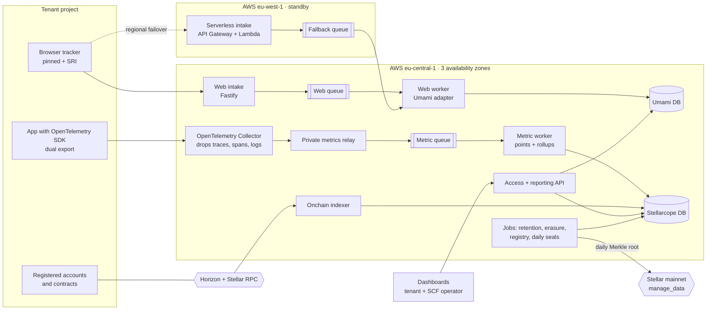
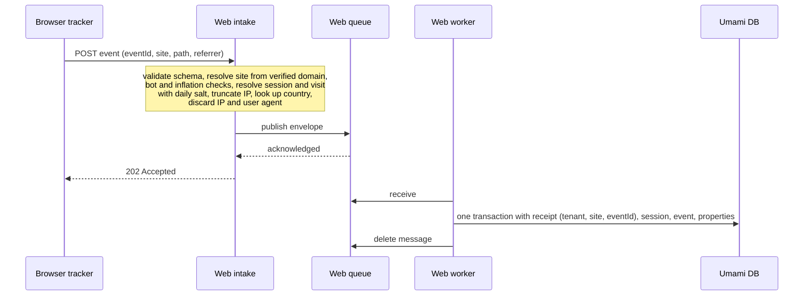
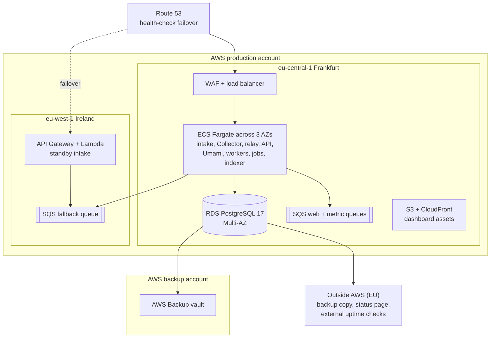

# Stellarcope technical architecture

This is the target architecture of Stellarcope, a shared web and API analytics service for projects building on Stellar. It responds to the SCF RFP *Web and API Analytics for Stellar Ecosystem Projects*.

- The [roadmap](roadmap.md) shows what exists today and which milestone delivers each part.
- The [technology decisions](decisions.md) record the evidence behind each choice.
- The [architecture diagrams](diagrams/) show every view in detail, with an editable [draw.io source](diagrams/stellarcope-architecture.drawio).

## 1. Overview

Stellarcope collects three kinds of data and turns them into one trusted view per project:

1. **Web events** from a version-pinned browser tracker on the project's site.
2. **API metrics** that the project's backend already produces with OpenTelemetry and dual-exports to us.
3. **Onchain activity** of the project's registered Stellar accounts and Soroban contracts, read from Horizon and Stellar RPC.

Every incoming event is checked at a stateless intake, buffered in a durable queue, and written exactly once by a worker into PostgreSQL. A single reporting API serves private tenant dashboards, the SCF operator console and machine consumers holding operator-issued API keys. Once a day, each project's summary is hashed into a Merkle tree whose root is anchored on Stellar, so anyone can verify that a published number was not changed afterwards.



## 2. Why Umami

The RFP asks proposers to build on Umami or GoatCounter and to justify the choice. We chose **Umami 3.5.0**, pinned:

- **Required metrics out of the box.** Umami reports page views, unique visitors, referrers, session duration, bounce rate, country, device and browser, plus custom events and properties. GoatCounter's deliberately minimal model does not provide session duration or bounce rate natively, so we would have had to build session tracking ourselves.
- **Same database as the API path.** Umami runs on PostgreSQL, so web analytics, API metrics, onchain activity and the control plane share one database technology, one backup and restore procedure, and one set of runbooks. This simplifies handover.
- **Same language.** Umami is TypeScript on Node, like Stellarcope. We reuse its session resolver directly instead of reimplementing visitor and visit semantics.
- **Existing bot detection.** The RFP asks us to build on the base project's bot detection. Umami's is the first layer of ours (section 7).
- **Proven integration.** In our [stack lab](../experiments/stack/FINDINGS.md), transactional writes into the real Umami 3.5 schema produced correct pageviews, visitors, visits and bounces through Umami's own reporting API, with no duplicates under eight concurrent replays and full rollback on failure.

The trade-off is coupling to Umami's database schema. We pin the version and require our adapter contract tests to pass before any Umami upgrade. If Umami ever ships an idempotent ingest API, we will switch to it after the same tests.

## 3. Components

| Component | Technology | Responsibility | Location |
|---|---|---|---|
| Tracker v2 | Dependency-free TypeScript | Sends page views and custom events with a fresh event ID per action, retries with the same ID, automatic Stellar Wallets Kit capture. Served from an immutable versioned URL with an SRI hash; no cookies or local storage. | `packages/tracker`, `packages/swk` |
| Web intake | Fastify 5, TypeBox 1.4 | Strict `WebEventV1` validation, site and domain resolution, bot and inflation checks, session and visit resolution, IP truncation and country lookup. Returns 202 only after durable queue publication. | `services/ingress` (public listener) |
| Serverless standby intake | API Gateway + Lambda | Same admission code; receives traffic only on regional failover and publishes to the fallback queue. | `infra/`, `services/ingress` |
| OpenTelemetry Collector | Official Collector 0.165 build | Accepts OTLP over HTTP and gRPC, authenticates the ingest credential, drops traces, spans and logs, forwards metrics to the relay. | `infra/collector` |
| Private metrics relay | Fastify 5 | Binds tenant identity from the verified credential, normalizes routes, splits requests into envelopes of at most 240 KiB, publishes to the metric queue. Loopback only. | `services/ingress` (private listener) |
| Queues | SQS Standard | Separate web and metric queues with dead-letter queues; fallback queue in the standby region. 7-day retention. | AWS |
| Web worker | Node, `pg` | One transaction per event in the Umami database: receipt, session, event and allowed properties. Replays are no-ops. | `services/worker`, `services/umami` |
| Metric worker | Node, `pg` | Stores immutable source points, reconstructs delta and cumulative streams, maintains minute and hourly rollups, quarantines invalid data. | `services/metrics` |
| Onchain indexer | Stellar SDK 17.4 | Reads registered accounts' operations from Horizon and contract invocations from Stellar RPC; stores daily counts per project. | `services/onchain` |
| Access service | Stellar SDK, JOSE | SEP-10 challenges and sessions, enrollment, domain verification (stellar.toml, DNS, meta tag), memberships, operator roles, approval mode, ingest credentials and registry, operator API keys. | `services/access` |
| Reporting API | Fastify 5, OpenAPI 3.0 | Tenant and operator queries over Umami reports and the Stellarcope database; documented metrics API for API-key consumers. | `services/api` |
| Jobs | PostgreSQL job table with leases | Retention, erasure, registry publication every minute, daily summaries, Merkle trees and Stellar anchoring. | `services/jobs` |
| Dashboards | React 19, Vite 8 | Tenant web, API and onchain views; SCF operator console; public opt-in project cards; documentation. | `src/` |
| Databases | RDS PostgreSQL 17, Multi-AZ | `stellarcope` database (control plane, metrics, onchain, seals) and a separate `umami` database, each with its own restricted roles. | AWS |

## 4. Data flows

### 4.1 Web event



- **Rejections.** An invalid payload gets 400. An event for an unknown or unverified site, or one that fails the bot checks, gets 403. Nothing is stored in either case.
- **Exactly-once effects.** A retry carries the same event ID. The worker's receipt insert conflicts and the transaction does nothing. The same ID with different content is a conflict and is quarantined.
- **Commit before acknowledge.** The worker deletes a queue message only after its database transaction commits. A crash in between causes a redelivery, which the receipt makes harmless.
- **Tenant from the server, never the payload.** The tenant is resolved from the site's verified domain. A `tenantId` field in a payload is rejected as an unknown field.

### 4.2 API metrics

1. The tenant adds a second exporter to its OpenTelemetry SDK (section 11). Its existing APM is untouched.
2. The Collector authenticates the ingest credential and drops traces, spans and logs.
3. The relay overwrites any caller-supplied tenant attribute with the verified one and applies the hard-coded path normalization rules: numeric IDs, Stellar G, C and M addresses, UUIDs, hex and crypto hashes, trailing slashes. A tenant-set `http.route` is respected.
4. The request is split into envelopes of at most 240 KiB and published. OTLP success is returned only after every part is published. A partial publish returns a retryable error.
5. The worker stores each point under a canonical identity (tenant, service, instance, metric, attributes, time), so retried points are no-ops and conflicting contents are quarantined.
6. Cumulative streams are converted with ordered differences over stored points, so a late point repairs rollups instead of inflating them (proven: 100 → 200 → late 150 reconstructs 100 + 50 + 50).
7. Minute rollups feed recent views. Hourly aggregates by tenant, service, route and status class feed p50/p95 latency and are kept for at least 24 months.

### 4.3 Onchain activity

Owners register Stellar accounts and Soroban contracts for their project. They prove control with a SEP-10 signature from the account, or by listing it in the stellar.toml of their verified domain. The indexer runs at least hourly: it reads account operations from Horizon and contract events and invocations from Stellar RPC, then upserts daily counts per project and subject. Only counts are stored: transactions, contract invocations and distinct interacting accounts. Stellar RPC keeps a limited event history, so the indexer's schedule stays well inside that window.

### 4.4 Daily seals

At 00:30 UTC, a job builds one canonical JSON summary per project for the previous day: web, API and onchain totals, plus the definitions version. Each summary is hashed with SHA-256. Leaves are sorted by tenant and folded into a Merkle tree. The root is written to Stellar with `manage_data` under the key `stellarcope:YYYY-MM-DD` from a dedicated anchor account. Late data is accepted for 24 hours; later corrections create explicit, separately anchored revisions instead of rewriting history. The public verifier recomputes a project's leaf and Merkle path and compares the root with the ledger entry on Horizon.

The prototype has anchored daily on testnet since 13 November 2026. The seal proves that a published summary was not changed after anchoring. It does not prove that every event was real; bot defenses (section 7) address that separately.

### 4.5 Queue message lifecycle

Web and metric queues are SQS Standard, so delivery is at least once and unordered. Every message moves through these states:

| State | Meaning |
|---|---|
| PUBLISHED | In the queue; admission has already returned 2xx |
| IN_FLIGHT | Received by a worker and hidden from other workers until its visibility timeout expires |
| COMMITTED | New receipt and effects committed |
| DUPLICATE | The receipt already existed, so nothing was written |
| QUARANTINED | Same identity with different content, or invalid; the quarantine record is committed |
| SKIPPED | The tenant is tombstoned, so no effects are written |
| DELETED | Removed from the queue after one of the four outcomes above committed |
| DEAD_LETTERED | Moved to the dead letter queue after reaching the receive limit; kept 14 days for investigation |

If a worker crashes, or its visibility timeout expires before it deletes the message, the message becomes visible again and is redelivered. The receipt turns the replay into a no-op. A message that keeps failing reaches the receive limit and moves to the dead letter queue instead of blocking the queue.

## 5. Tenancy, identity and access control

| Principal | Authenticates with | Can do |
|---|---|---|
| Project owner or member | SEP-10 wallet login, then an HttpOnly session cookie with CSRF protection | See and manage only their own project's data, sites, accounts, credentials and erasure |
| SCF operator | SEP-10 wallet login; role granted administratively, never self-granted | Global view, project removal, approval mode, issuing and revoking metrics API keys |
| Metrics API consumer | Operator-issued API key (hashed at rest, revocable) | Read-only access to the documented metrics API |
| Tenant service | Signed ingest credential in OTLP headers (90-day maximum validity, overlapping rotation) | Write metrics for its own tenant only |
| Browser tracker | None; site ID resolved against verified domains | Submit events for that site only |

Isolation is enforced in three layers:

1. **API authorization** checks the principal's role and tenant on every request. An invalid session or API key gets 401; a valid principal whose role does not permit the action gets 403. Operators read the global view through a dedicated read-only role that returns aggregates across tenants, never another tenant's raw rows.
2. **PostgreSQL row-level security.** Runtime roles do not own tenant tables and cannot bypass RLS. Each transaction pins one connection and sets the tenant context for that transaction only, so pooled connections cannot leak context.
3. **Separate Umami database role.** It is restricted to the tables the adapter needs. Dashboard callers never get direct database access.

Login identities (wallet addresses of owners and operators) live only in the control plane and are never joined with anonymous analytics.

**Enrollment.** Self-service by default. Operators can switch to approval-required enrollment at any time. Creating the project and its owner membership is a single transaction. Every project is in one of these states, and each transition records the actor and the reason:

| State | Meaning | Entered when |
|---|---|---|
| PENDING_APPROVAL | Waiting for an operator; accepts no data | A project enrolls while approval mode is on |
| ACTIVE | Accepts data; visible to its owner | A project enrolls in self-service mode, an operator approves it, or an operator reinstates a suspended project |
| DECLINED | Never accepted data | An operator declines a pending project |
| SUSPENDED | Ingestion rejected; data kept | An operator suspends an active project |
| REMOVED | Tombstone written; data hidden; erasure scheduled | An operator removes the project, or its owner deletes it |
| ERASED | Data deleted; the tenant ID is never reused | The erasure job completes |

Tombstones take precedence over queue replay and are reapplied after any database restore.

**Domain verification.** A site accepts events only while its domain is verified through stellar.toml, a DNS record or a meta tag. Verification is rechecked on a schedule. A domain that fails a recheck stops accepting events until it is verified again.

**Ingest registry.** A signed registry of credential and tenant suspensions is published every minute and cached by every intake. If it goes stale, admission continues for up to 60 minutes, then fails closed. Events admitted under a stale registry are reconciled against revocations afterwards and quarantined if their credential was revoked.

## 6. Privacy and GDPR

This section describes production design requirements, not the current pilot or a finding of legal compliance. The [privacy and GDPR review](privacy-and-gdpr.md) records the legal assumptions and launch requirements; the product [data processing page](../src/docs/data-processing.tsx) distinguishes the planned service from the US-hosted pilot. Privacy captions in the architecture diagrams are simplified design targets and must be read with these qualifications.

| Planned analytics records | Excluded from analytics records |
|---|---|
| Page path without query string, referrer, country, browser, OS, device type, language | IP addresses, full user agents |
| Session and visit IDs (salted hashes, salt rotates daily) | Cookies or any identifier stored on the visitor's device |
| Custom event names and allowlisted, bounded properties | Visitor wallet addresses, query strings, request bodies |
| API route, status code, latency histograms, service name | Traces, spans, logs, exemplars |
| Daily onchain counts for registered accounts and contracts | Addresses of accounts interacting with a project |

- **IP addresses.** Admission uses IP and User-Agent transiently for identifier derivation and filtering. Before country lookup, the last IPv4 octet or last 80 IPv6 bits are removed. Raw IP/UA must not enter analytics tables, queue payloads or application access logs. Infrastructure security logs and provider access are separate processing that must be reviewed and disclosed; the current pilot uses edge-provided country information instead.
- **Daily identifiers.** The intended Umami resolver uses daily salts and site-scoped identifiers to reduce linkability. Salt removal, replicas, caches and backups need operational verification. Hashes, event records and small-count aggregates are not automatically anonymous; do not promise that reidentification or cross-day inference is impossible.
- **No tracker device storage.** The web tracker uses no cookies or local storage. This does not establish an ePrivacy consent exemption. Assess browser-information access, purposes and national requirements; gate collection on consent where required. Separate necessary dashboard authentication cookies must be disclosed.
- **Data residency.** The target analytics infrastructure is in the EU: AWS Frankfurt (primary), Ireland (standby) and an EU-located external backup provider. Publish the actual provider entities and all processing/access locations, including support, security and delivery services. EU regions alone do not rule out international transfers. The pilot is US-hosted.
- **Rights and erasure.** Pseudonymous records can remain personal data, so applicable visitor rights must be assessed as well as tenant and account-holder requests. The planned dashboard supports tenant-triggered erasure; backups expire within 35 days and erasure tombstones are reapplied before restored data serves traffic. Published ledger roots cannot be withdrawn. Removing stored summary text must preserve other tenants' proofs, and completion claims must explain backups and immutable commitments.
- **Roles and purposes.** Tenant-directed analytics normally uses a controller–processor arrangement with an Article 28 agreement. SCF comparisons, funding decisions and independent reuse require their own purpose, role and legal-basis analysis. Operator access does not itself authorize independent reuse. Publish controller identities, privacy contacts, recipients, transfers and retention before onboarding.

| Data | Retention |
|---|---|
| Raw web events (Umami) | 90 days |
| Raw metric points | 7 days |
| Event receipts | 8 days |
| Minute rollups | 30 days |
| Hourly API aggregates | at least 24 months |
| Daily onchain counts | at least 24 months |
| Daily seals (aggregate summaries and roots) | permanent |

These are engineering retention targets. In particular, “at least 24 months” does not define a maximum for personal data. Before launch, set maximum periods or meaningful deletion criteria for aggregates, identity records, support, audit and provider security logs. Verify scheduled deletion, queue expiry, backup expiry and restore behavior. The full privacy strategy, actual residency/subprocessor register, signed processing arrangements and jurisdiction-specific consent assessment are launch requirements, not established by this architecture alone.

## 7. Security

**Supply chain.**
- The tracker has no runtime dependencies. It is built from tagged source and served from an immutable versioned URL with an SRI hash; tenants upgrade only by changing the version they embed. No code is ever loaded dynamically.
- Lockfiles, `npm ci` with strict peers and advisory checks run in CI.
- Container images are built from the [maintained definitions](../infra/images/README.md), pinned by digest and scanned before release.

**Bot and inflation defenses**, in layers:
1. Umami's built-in bot detection.
2. Proof that the tracker's JavaScript actually ran: a short-lived signed token the script must obtain before events are accepted, which rejects direct server posts.
3. Skeptical scoring of many distinct fingerprints from one IP address.
4. Per-site and per-IP rate limits behind a web application firewall.

An attack test suite in CI reports raw versus counted events for each scenario.

**Secrets and keys.**
- Secrets live in AWS Secrets Manager under KMS, readable only by the role that needs them.
- The anchor account signs only seal transactions and holds a minimal balance.
- The SEP-10 signing key is dedicated to authentication and should never appear in a transaction.

**Onchain monitoring.** Alerts fire on unexpected anchor-account operations, signer or threshold changes, low balance, failed or missed daily anchors, and any activity on the SEP-10 signing account. A STRIDE threat model covers the anchor account, SEP-10 keys, domain takeover, seal forgery and replay, and analytics inflation.

**Logging.** No request bodies, raw URLs, IPs, headers or exception text reach logs; request IDs carry diagnostic context. The current [ingress skeleton](ingress.md) already enforces this.

## 8. Reliability and the 99.99% commitment

**Definition.** Ingestion availability is the share of valid ingestion requests that receive a 2xx response within 2 seconds. Independent external checks from multiple regions measure it every minute, with no maintenance exclusions, and a monthly report publishes the result. At 99.99%, the monthly budget is about 4.3 minutes. Dashboard availability is measured the same way against a 99.90% target.

| Failure | Effect on ingestion | Mitigation |
|---|---|---|
| One availability zone lost | None | Intake replicas in three zones behind the load balancer; RDS Multi-AZ failover |
| Database failover or outage | None | The queue decouples admission from the database; workers resume afterwards |
| Primary region lost | Brief, until DNS fails over (target under 2 minutes) | Route 53 health checks fail intake over to the serverless standby, which publishes to the fallback queue; workers drain it on recovery |
| Queue unavailable in the primary region | Brief | Retries with stable event IDs; failover to the standby queue |
| Ingest registry unavailable | None for 60 minutes | Bounded stale window, then fail closed |
| Faulty release | Brief | Rolling deployment with health checks and automatic rollback; an error-budget policy freezes releases when the budget is spent |
| Traffic burst | None up to tested load | Sized for 10× the 1M requests/day average and validated by load tests |

Every request carries a stable event ID, and both the tracker and OpenTelemetry SDKs retry, so a short outage delays data rather than losing it.

**Dashboards and processing** run in the primary region only. During a primary-region outage, ingestion continues, but dashboards are unavailable until the region recovers or is rebuilt from code and backups. We accept this because the dashboard target (99.90%) leaves far more room than the ingestion target.

## 9. Infrastructure



- **Infrastructure as code.** All infrastructure is defined in OpenTofu under `infra/`, with staging and production environments. Every change runs a plan in CI.
- **Portability.** The system uses standard containers, standard PostgreSQL and a queue behind our own `QueuePublisher` interface, so a future operator can rebuild it in their own AWS account, or move to another provider.
- **Account separation.** Production and backups use separate AWS accounts, so one compromised account cannot delete both data and backups.
- **Monitoring.** CloudWatch collects metrics, alarms and logs inside AWS. The public status page and the independent uptime checks run outside AWS, so they stay available during an AWS incident (section 8).

## 10. Monorepo structure

```text
packages/tracker     browser tracker (versioned, SRI)            existing v1, v2 planned
packages/swk         Stellar Wallets Kit capture                  existing prototype
packages/ingestion   strict event contracts and receipt IDs       implemented
packages/core        normalization, histograms, Merkle, sessions  existing prototype
services/ingress     public intake and private metrics relay      skeleton implemented
services/access      SEP-10, enrollment, roles, credentials, keys planned
services/umami       pinned Umami schema adapter                  planned (lab-proven)
services/worker      queue consumers                              planned
services/metrics     point ledger, reconstruction, rollups        planned (lab-proven)
services/onchain     Horizon and RPC indexer                      planned
services/api         reporting and metrics API                    existing prototype
services/jobs        retention, erasure, registry, seals          planned (seals prototyped)
src/                 dashboards, operator console, docs           existing prototype
db/migrations        versioned SQL migrations                     planned
infra/               OpenTofu, Collector build, service images    images implemented
engineering/         architecture, decisions, plans, runbooks     ongoing
```

Every package and service carries its own tests. `npm run check` runs types, lint, formatting, tests and the build. Everything is MIT licensed.

## 11. Tenant integration

**Web.** Paste one versioned snippet; the URL below is illustrative.

```html
<script defer src="https://stellarcope.xyz/v2.0.0/s.js"
  integrity="sha384-…" crossorigin="anonymous" data-site="YOUR_SITE_ID"></script>
```

- **Static HTML:** paste the snippet into each page.
- **Single-page apps:** client-side navigations are tracked automatically.
- **SSR frameworks** such as Next.js: render the snippet in the document head.
- **Stellar Wallets Kit:** connect and sign events are captured with no extra configuration.

**API.** Keep your existing exporter and add a second one:

```ts
const meterProvider = new MeterProvider({
  resource,
  readers: [
    new PeriodicExportingMetricReader({ exporter: yourExistingExporter }),
    new PeriodicExportingMetricReader({
      exporter: new OTLPMetricExporter({
        url: 'https://otlp.stellarcope.xyz/v1/metrics',
        headers: { authorization: `Bearer ${process.env.STELLARCOPE_INGEST_KEY}` },
      }),
    }),
  ],
})
```

Standard HTTP server instrumentation produces the required attributes. Set `http.route` in your middleware if you want finer route control than the default normalization.

**Onchain.** Register accounts and contracts in the dashboard. Prove control with a SEP-10 signature, or by listing them in your stellar.toml.

## 12. Operations, support and handover

**Support model.**
- A public GitHub issue tracker with response labels: responses within 5 business days, resolutions within 10.
- Security reports through GitHub private vulnerability reporting; critical and high vulnerabilities patched within 24 hours.
- A monthly operations report covering availability, incidents, upgrades and data quality.
- Quarterly restore and failover drills.

**Handover** to a community-appointed operator, between months 6 and 12 of the service window:

1. The operator receives read access, the runbooks and a walkthrough.
2. The operator rebuilds the stack in their own AWS account from the monorepo with OpenTofu.
3. A rehearsed data migration restores the latest backups into their account; queues cut over so no event is lost.
4. DNS moves to the new deployment; `stellarcope.xyz` is transferred or permanently redirected.
5. The anchor account changes hands on chain: the operator adds their signer with `set_options`, then ours is removed.
6. Repository ownership is transferred.
7. A shadow period follows: the operator runs the system while our team supports it.
8. Handover is complete once SCF confirms the operator runs the system independently.

## 13. Decentralization and verifiability

- **Anyone can audit or run it.** Everything is open source under MIT, including infrastructure as code, so the code can be audited and the service rebuilt.
- **The stewardship leaves our hands.** The service is designed for a community operator to take over, with zero fees for anyone.
- **Published numbers are independently checkable.** Daily seals on Stellar let anyone verify a summary against the public ledger, without trusting the operator.
- **Stellar dependencies stay current.** The system follows the latest stable Stellar SDK and protocol releases; currently `@stellar/stellar-sdk` 17.4.0.

## 14. Design guarantees

These hold across every component and every change:

- **Public web endpoint.** The only public web endpoint is `POST /v1/events`. It accepts a strict `WebEventV1` payload, and the tenant is resolved by the server. The legacy `/e` endpoint stays best effort until old clients migrate.
- **Accepted means published.** Admission returns success only after `QueuePublisher.publish(envelope, signal)` resolves. Only the queue adapter talks to the queue service.
- **Web receipt identity.** Web delivery uses `webReceiptId(tenantId, siteId, eventId)`. The receipt and its effects commit in the same Umami transaction. Metric points have their own canonical point identity.
- **Metrics path.** Collector metrics arrive at `/v1/metrics`, and the downstream relay is private. No in-memory buffer or batch processor acknowledges data before it is published to the queue.
- **Commit before acknowledge.** Workers acknowledge a queue message only after a durable, idempotent database outcome or a committed quarantine. They check deletion and suspension tombstones before writing any effect.
- **Database access.** Transactions pin one connection and set the tenant context for that transaction only. Runtime roles never own tenant tables or bypass row-level security. Umami has its own database, role and migrations.
- **Points before rollups.** Raw metric points are stored before any rollup derives from them. A correction replaces the affected per-stream contribution; it never adds to the old result.
- **Measured availability.** The 99.99% ingestion and 99.90% dashboard commitments are verified by external measurement (section 8). No local test, replica count or supplier SLA establishes them.

## 15. Delivery

The [roadmap](roadmap.md) shows which milestone delivers each component: web analytics first, then API metrics, onchain activity and operator tools, then production on mainnet, followed by twelve months of service and the handover.
